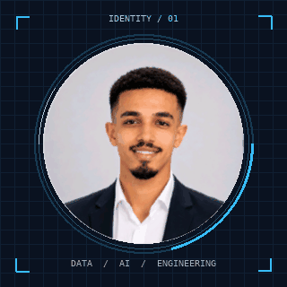

  

  <a href="https://mohannad-elhachimi.vercel.app/">Portfolio</a> &nbsp;·&nbsp;
  <a href="https://www.linkedin.com/in/mohannad-elhachimi/">LinkedIn</a>

## 01 / About me

  

I am a Data Science & Artificial Intelligence engineering student at **ENSA Marrakech, Morocco**. My interests include applied machine learning, statistical modeling and building data-driven solutions to real-world problems.

- **Currently:** strengthening my engineering foundations through hands-on projects and experimentation.
- **Leadership:** Head of the Advisory Office Unit — DSIA Club.
- **Open to:** internships, research collaborations and technical projects.

## 02 / Technical toolkit

**Programming & databases**

**Data science & machine learning**

**Development & tools**

## 03 / Selected work

| Project | Focus | Stack |
| :--- | :--- | :--- |
| [AquaPilot AI](https://github.com/mohannadelhachimi/aquapilot-ai) | Water intelligence and anomaly detection prototype | Python, scikit-learn, Streamlit |
| [Morocco Data Explorer](https://github.com/mohannadelhachimi/disparites-emploi-maroc) | Regional labor-market analysis using official Moroccan statistics | Pandas, NumPy, Matplotlib |
| [Personal Portfolio](https://mohannad-elhachimi.vercel.app/) | Bilingual engineering portfolio | React, Vite |

## 04 / GitHub activity

### Contribution snake

---

BUILD WITH PURPOSE · LEARN WITH CURIOSITY · ENGINEER FOR IMPACT

